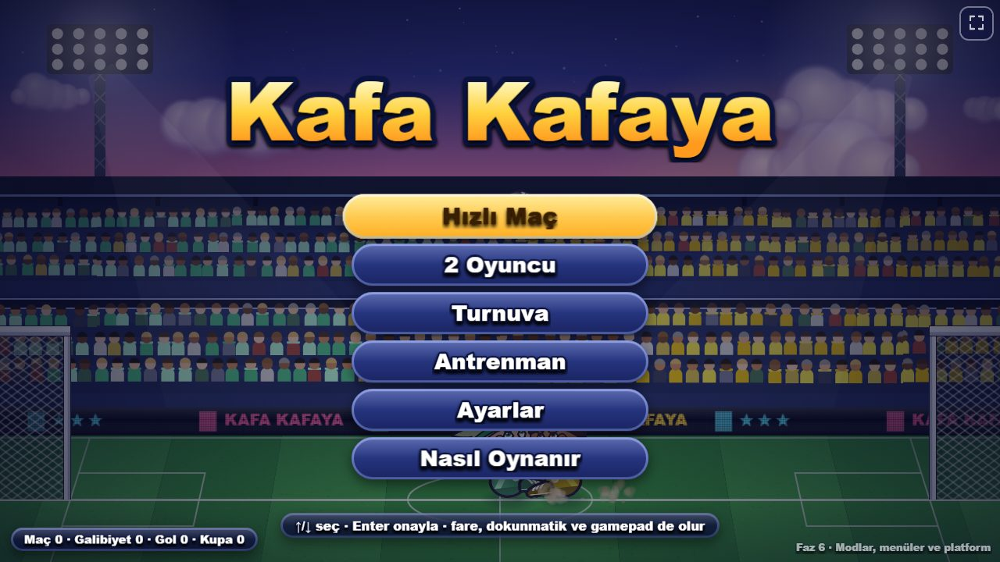
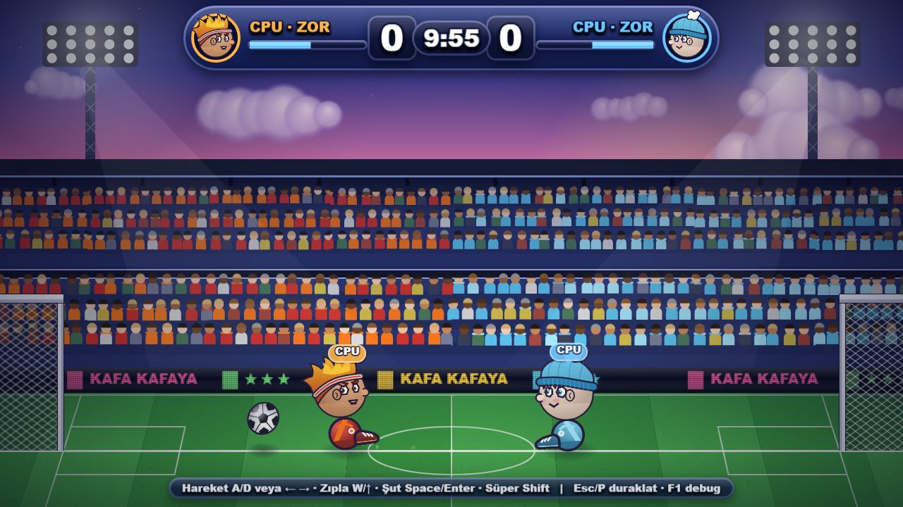
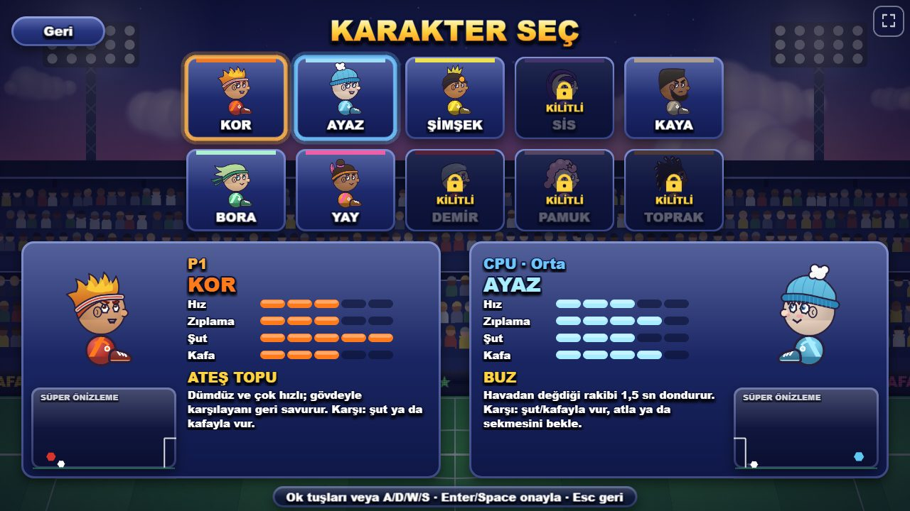
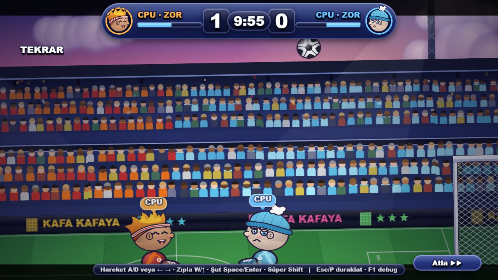
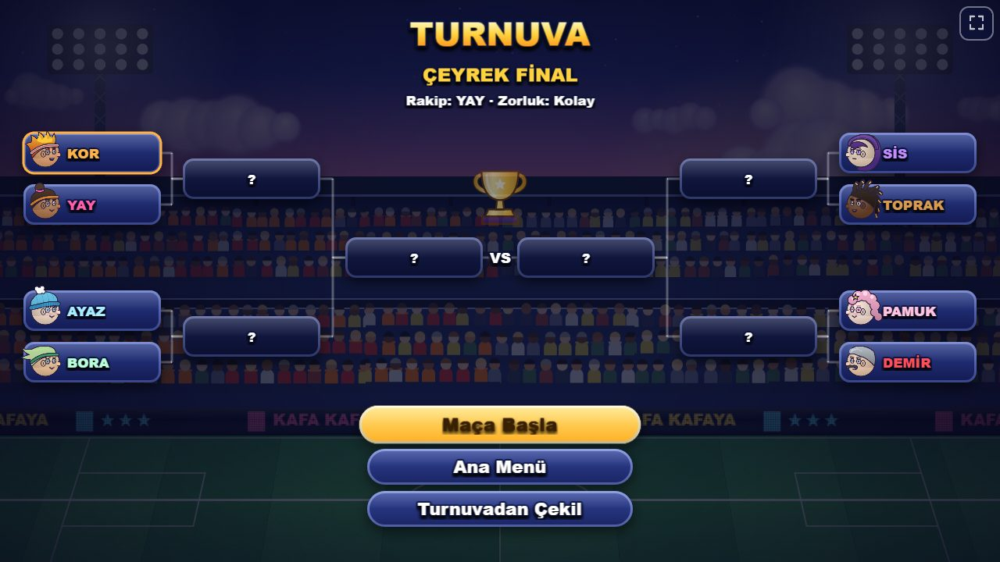
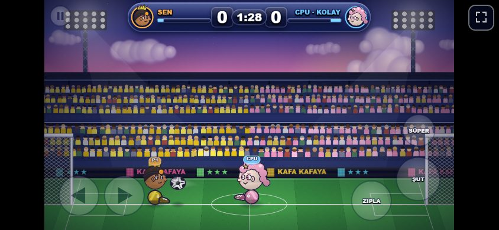
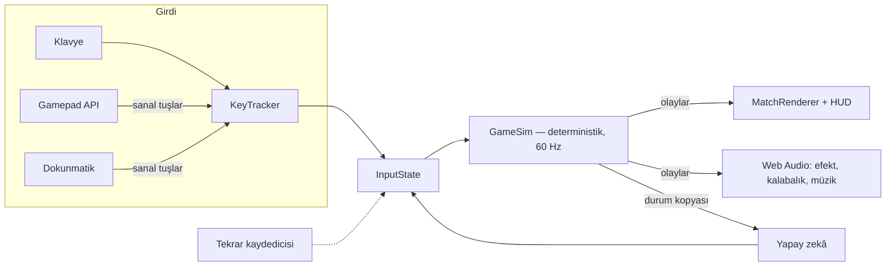

# Kafa Kafaya

[](https://github.com/emengin/kafa-kafaya/actions/workflows/deploy.yml)
[](https://github.com/emengin/kafa-kafaya/releases)
[](LICENSE)

Tarayıcıda oynanan, 2D yandan görünümlü, 1v1 bir **kafa topu** oyunu: büyük kafalı 10 özgün
karakter, her birine özel süper şutlar, süzülen güçlendirici balonları, gol tekrarları ve turnuva.
Kurulum gerekmez; masaüstünde, telefonda ve gamepad'le oynanır, çevrimdışı da çalışır.

_A browser-based 2D one-on-one head soccer game with 10 original characters, unique super shots,
power-ups, instant goal replays and a knockout tournament. Plays on desktop, mobile and gamepad,
works offline (PWA). UI in Turkish and English._

### ▶ [Hemen oyna — emengin.github.io/kafa-kafaya](https://emengin.github.io/kafa-kafaya/)

|                                                     |                                                 |
| --------------------------------------------------- | ----------------------------------------------- |
|               |               |
| **Ana menü** — arkada canlı AI vs AI maçı           | **Maç** — canlı yüz ifadeleri, güç barları      |
|      |      |
| **Karakter seçimi** — istatistikler, süper önizleme | **Gol tekrarı** — ağır çekim, yakın plan kamera |
|          |            |
| **Turnuva** — 8 kişilik eleme ağacı                 | **Mobil** — yarı saydam dokunmatik butonlar     |

## Özellikler

- **Sıkı oynanış:** kendi deterministik fizik motoru (sabit 60 Hz), ivmeli hareket, coyote time,
  değişken zıplama, açıya duyarlı şut ve kafa vuruşu; altın gol uzatması.
- **10 özgün karakter**, her birinin istatistikleri ve **kendi süper şutu**: Ateş Topu, Buz,
  Zikzak, Işınlanma, Dev Top, Kasırga, Gökkuşağı, Mıknatıs, Serap, Sarsıntı.
- **6 güçlendirici:** Büyük Kafa, Rakibi Küçült, Hız, Rakip Kalesini Büyüt, Rakibi Dondur, Çift
  Zıplama.
- **Yapay zekâ** (Kolay / Orta / Zor): topun yolunu gerçek fizikle ileri simüle eder, yalnızca
  ekranda görüneni bilir, insanla aynı kurallarla oynar.
- **Modlar:** Hızlı Maç, 2 Oyuncu (aynı cihaz), Turnuva (giderek zorlaşan rakipler, kupa, yeni
  karakter kilidi), Antrenman (süresiz, top sıfırlama).
- **Gol tekrarı:** golden sonra son saniyeler deterministik olarak yeniden oynatılır — ağır çekim,
  topu izleyen kamera, "Atla".
- **Görsel ve ses:** tüm grafikler kodla çizilir, tüm sesler Web Audio ile sentezlenir (harici
  görsel/ses dosyası yok); parçacıklar, hit-stop, sarsıntı, prosedürel müzik ve kalabalık.
- **Platformlar:** klavye, **dokunmatik** (çoklu dokunuş) ve **Gamepad API** (2 kol); yatay ekran
  uyarısı, tam ekran; **PWA** (ana ekrana eklenebilir, çevrimdışı).
- **Erişilebilirlik:** renk körü modu (Okabe–Ito renkleri + kimlik halkası + ▲/● şekilleri), efekt
  yoğunluğu (parçacıklar, ekran parlamaları, yakınlaşma), ekran sarsıntısı aç/kapa, TR/EN.
- **Kayıt:** ayarlar, açılan karakterler ve istatistikler tarayıcıda saklanır; bozuk kayıt güvenli
  varsayılana döner.

## Kontroller

| Eylem    | Oyuncu 1 (klavye) | Oyuncu 2 (klavye) | Gamepad (1. kol P1, 2. kol P2) | Dokunmatik (P1) |
| -------- | ----------------- | ----------------- | ------------------------------ | --------------- |
| Hareket  | A / D             | ← / →             | Sol çubuk / d-pad              | ◀ ▶             |
| Zıpla    | W                 | ↑                 | A                              | ZIPLA           |
| Şut      | Space             | Enter             | X / B                          | ŞUT             |
| Süper    | Sol Shift         | Sağ Shift         | RB / RT                        | SÜPER           |
| Duraklat | Esc / P           | Esc / P           | Start                          | II (sol üst)    |

- **Süper:** güç barı (isimlerin altında) dolunca Süper'e bas; bir sonraki şut ya da kafa
  karakterin süper şutu olur. Süper topa şut ya da kafayla **aktif** vurmak her zaman temiz bir
  karşılıktır.
- **Tek kişilik modlar** (Hızlı Maç, turnuva, antrenman): iki tuş takımı, iki kol ve dokunmatik
  birlikte Oyuncu 1'i yönetir.
- **Antrenman:** R topu sıfırla · F süper barını doldur · T kukla rakip (gamepad: Y · LB · Back).
- **Gol tekrarı:** Enter / Space / A ya da "Atla" ile geçilir; Ayarlar'dan kapatılabilir.
- **Menüler:** ↑/↓ + Enter, fare, dokunmatik ya da gamepad (A onay, B geri); ←/→ değer değiştirir.
  F1 debug katmanını açar.
- **Ses:** tarayıcılar sesi ilk tuş/tıklama/dokunuşa kadar başlatmaz.

## Kurulum ve geliştirme

Node.js 20+ gerekir.

```bash
git clone https://github.com/emengin/kafa-kafaya.git
cd kafa-kafaya
npm install
npm run dev          # geliştirme sunucusu (http://localhost:5173)
```

| Komut                 | Ne yapar                                                                 |
| --------------------- | ------------------------------------------------------------------------ |
| `npm run build`       | Tip denetimi + üretim derlemesi (`dist/`, PWA dosyaları dahil)           |
| `npm run preview`     | Derlenmiş sürümü yerelde sun (`/kafa-kafaya/` altında)                   |
| `npm test`            | Vitest birim testleri                                                    |
| `npm run test:e2e`    | Playwright duman testi (önce `npm run build`)                            |
| `npm run screenshots` | README ekran görüntülerini yeniden al (`docs/screenshots/`)              |
| `npm run lint`        | ESLint (tip denetimli, sihirli sayı yasağı) + Prettier denetimi          |
| `npm run format`      | Prettier ile biçimlendir                                                 |
| `npm run simulate`    | AI vs AI headless maçlar: skor dağılımı, süperler, sıkışma raporu, denge |

`npm run simulate -- --characters --matches 40 --jobs 10` 45 karakter eşleşmesini iki tarafta da
oynatır; `--matrix` zorluk eşleşmelerini, `--p1 hard --p2 easy` belirli seviyeleri, `--c1 kor --c2
kaya` karakterleri, `--seed N` tohumu seçer.

**Geliştirme kısayolları (URL parametreleri):** `?debug=1` (debug katmanı, `window.__KAFA_GAME__`),
`?cpu=easy|medium|hard` (doğrudan CPU maçı), `?cpu1=…` (AI vs AI), `?c1=kor&c2=kaya` (karakterler),
`?seed=N`, `?duration=N`, `?quality=low|medium|high`, `?unlock=all`, `?touch=1`.
Karakter kimlikleri: `kor ayaz simsek sis kaya bora yay demir pamuk toprak`.

## Mimari



- **Simülasyon Phaser'dan bağımsız ve deterministiktir** (`src/game`, `src/physics`): aynı başlangıç
  durumu + aynı girdi dizisi → birebir aynı maç. Gol tekrarı bunun üzerine kurulu: son saniyelerin
  anahtar kareleri ve girdileri halka tamponda tutulur, gol yeniden oynatılır.
- **Oyuncular yalnızca `InputState` görür:** klavye, gamepad, dokunmatik, yapay zekâ ve tekrar aynı
  arayüzü üretir; gamepad ve dokunmatik "sanal tuş" olarak klavyeyle aynı yoldan okunur.
- **Yapay zekâ hile yapmaz:** ekrandaki bilginin bir kopyasını gecikmeli algılar, topun yolunu
  simülasyonun kendi koduyla tahmin eder.
- **Phaser yalnızca çizim, sahne ve girdi** için; tüm dokular Canvas 2D ile kodla, tüm sesler Web
  Audio ile üretilir. Her karede çizilen şekiller çöp üretmeyen `LiteGraphics` ile; üretim
  derlemesinde yalnızca kullanılan modülleri içeren özel bir Phaser derlemesi.
- **Tüm ayar ve denge değerleri** `src/config/gameConfig.ts` içinde; kodda sihirli sayı yasağı lint
  ile zorlanır. **Tüm metinler** `src/i18n` içinde (TR/EN).

```
src/
  config/     gameConfig.ts — tüm denge/ayar değerleri
  physics/    deterministik fizik ve sabit adımlı döngü
  game/       GameSim, kurallar, yapay zekâ, karakterler, süperler, güçlendiriciler, turnuva, tekrar
  input/      InputState, klavye, sanal tuşlar (gamepad, dokunmatik)
  scenes/     Boot → Preload → Menu → Select → Match / Tournament → Trophy
  ui/         maç çizimi, HUD, menüler, dokunmatik butonlar, tekrar kaplaması
  art/        kodla üretilen dokular (karakterler, stadyum, efektler, arayüz, kupa)
  fx/         parçacık havuzu, ağ dalgası, animasyon, hit-stop, sarsıntı, kamera, kalite
  audio/      Web Audio motoru, efektler, kalabalık, prosedürel müzik
  save/       localStorage kaydı (alan alan doğrulama)
  platform/   dokunmatik algılama, tam ekran, dikey ekran uyarısı, PWA kaydı
  i18n/       TR/EN metinler
scripts/      simulate.ts, pwa/ (manifest, simgeler, service worker), phaser/ (özel derleme)
e2e/          Playwright duman testi ve ekran görüntüleri
docs/         GAME_DESIGN.md (tasarım), PROGRESS.md (faz günlüğü, ölçümler)
```

Ayrıntılı tasarım: [docs/GAME_DESIGN.md](docs/GAME_DESIGN.md) · geliştirme günlüğü, ölçümler ve
denge tabloları: [docs/PROGRESS.md](docs/PROGRESS.md) · sürüm notları: [CHANGELOG.md](CHANGELOG.md).

## Katkı rehberi

Katkılar memnuniyetle karşılanır. Bir değişiklik göndermeden önce:

1. **`npm run lint`, `npm test` ve `npm run build && npm run test:e2e` yeşil olmalı** (CI aynı
   adımları çalıştırır).
2. **Sihirli sayı yok:** yeni bir değer `src/config/gameConfig.ts`'e (ya da dosya sonunda adlandırılmış
   bir sabite) girer; lint bunu zorlar.
3. **Metinler `src/i18n/strings.ts`'te**, iki dilde birden; anahtar eşitliği testle denetlenir.
4. **Determinizmi bozma:** simülasyon kodunda `Math.random`, gerçek zaman ya da Phaser kullanılmaz;
   rastgelelik tohumlu `SeededRandom`'dan gelir. Fizik/yapay zekâ değişikliklerinde determinizm ve
   tekrar testleri geçmeli; denge etkisini `npm run simulate -- --characters` ile ölç.
5. **Harici varlık yok:** görseller Canvas 2D ile kodla, sesler Web Audio ile üretilir.
6. **Testler:** saf mantık için Vitest testi ekle; sahne akışını etkileyen değişikliklerde duman
   testini çalıştır.
7. **Commit mesajları** kısa ve açıklayıcı (`feat:`, `fix:`, `docs:`, `test:`, `perf:` …), değişikliğin
   nedenini anlatan bir gövdeyle.

Hata bildirimi ve öneriler için [Issues](https://github.com/emengin/kafa-kafaya/issues).

## Yayın

`main` dalına her push'ta GitHub Actions lint + birim test + derleme + Playwright duman testi
çalıştırır ve `dist/` klasörünü GitHub Pages'e yayınlar. `v*` etiketi GitHub Release'i oluşturur.

## Lisans

[MIT](LICENSE) — tüm karakterler, görseller ve sesler özgündür.
